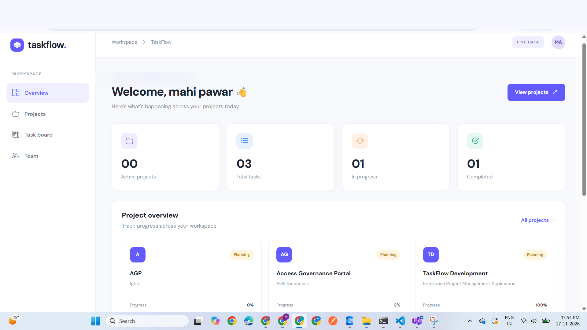
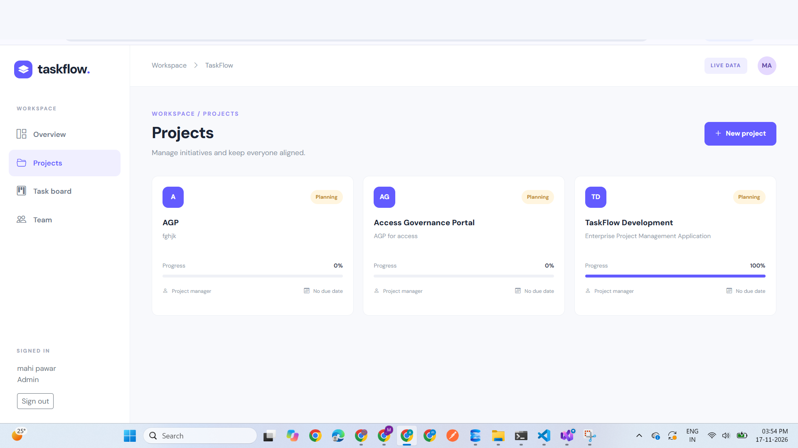
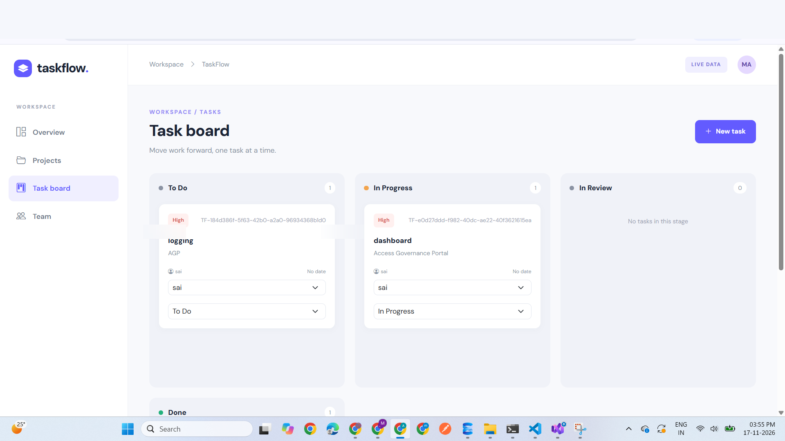
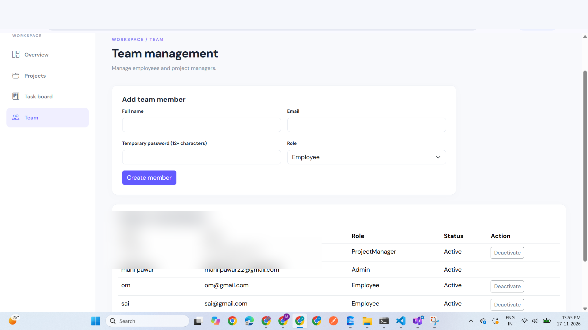
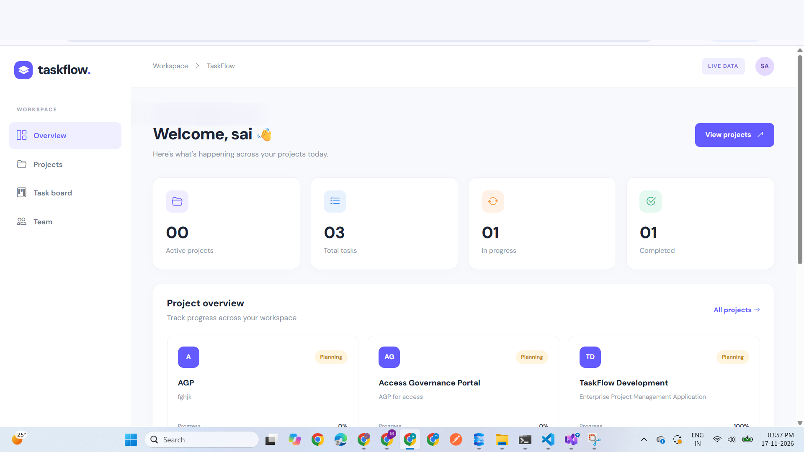
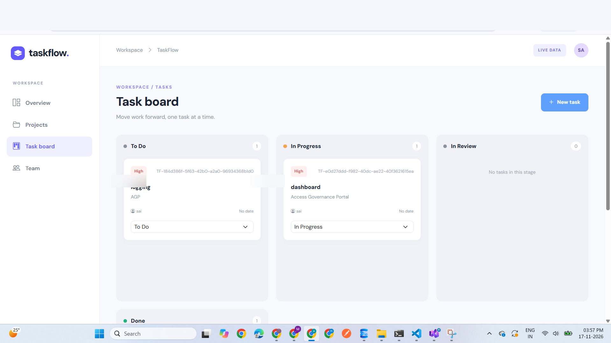
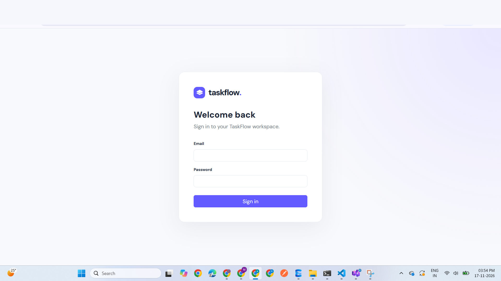
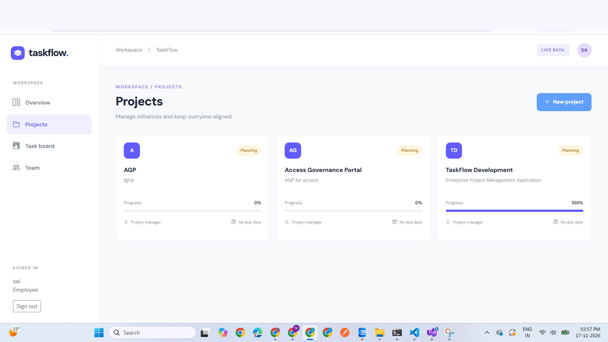
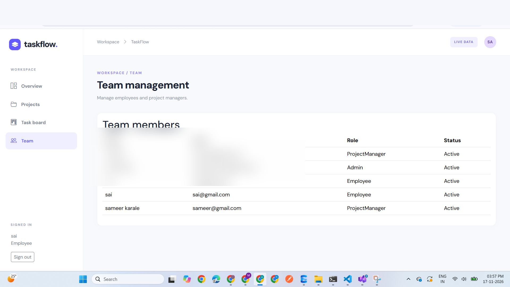
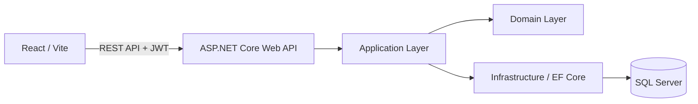

# TaskFlow — Full-Stack Project Management Application

**React · ASP.NET Core Web API (.NET 10) · SQL Server · Entity Framework Core · JWT**

TaskFlow is a full-stack project and task management application. This **public repository is a portfolio showcase only**; application source code is kept in a separate private repository.

## Application preview

### Admin dashboard

### Projects

### Task board

### Team management

### Employee experience
| Employee dashboard | Employee task board |
| --- | --- |
|  |  |

Additional screenshots

**Login**

**Employee project view**

**Employee team view**

## Features demonstrated

- Initial administrator setup and sign-in using JWT authentication
- Project creation and progress visualization
- Task creation, assignment, and status updates (To Do, In Progress, In Review, Done)
- Team account creation, roles, and activation management
- Dashboard summaries and employee task views
- SQL Server persistence through Entity Framework Core

**Scope note:** Screenshots show the current UI, not a security certification. Role-based access and project ownership behavior require further testing; for example, an employee view currently displays project listings and a New Project button.

## Architecture

| Layer | Technologies |
| --- | --- |
| Frontend | React, Vite, JavaScript |
| Backend | C#, ASP.NET Core Web API, .NET 10 |
| Data access | Entity Framework Core, SQL Server |
| Security | JWT bearer authentication, role-based authorization (testing ongoing) |
| Organization | API, Application, Domain, Infrastructure |

## Demo availability

The application currently runs locally. **No public live demo is available**; `localhost` URLs are not accessible to recruiters. A demo video may be added later using fictional data.

## Development and attribution

I configured, integrated, and tested core workflows across the frontend, API, and database. Development included AI assistance and third-party open-source dependencies. This portfolio does not assert exclusive ownership of AI-generated or third-party material.

## Source code

The application source is maintained privately. This repository includes documentation and redacted screenshots only—no credentials, environment secrets, database exports, or application source.

© 2026. Portfolio documentation and original presentation materials; third-party rights remain with their respective owners.
