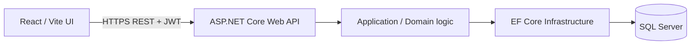

# TaskFlow — Project Management Application

**Full-stack portfolio project | ASP.NET Core Web API · React · SQL Server**

TaskFlow is a project and task management application with role-based workflows for administrators, project managers, and employees. This repository is a **public portfolio showcase only**. The application source code is maintained separately in a private repository.

## Overview

TaskFlow helps teams organize projects, assign tasks, track work status, and view progress through a dashboard.

## Features demonstrated

- **Authentication:** Admin setup, login, and JWT-based API authentication.
- **Project management:** Create projects and designate a project manager.
- **Task management:** Create and assign tasks; track status through the workflow.
- **Team management:** Admin can create employee and project-manager accounts and manage account activation.
- **Role-based access:** Admin, ProjectManager, and Employee workflows with backend authorization.
- **Dashboard:** Project and task summaries with recent activity views.

**Implementation note:** Role and project ownership are distinct. A manager's access to a specific project depends on the project ownership/authorization rules. This showcase does not claim those workflows have passed a full security audit.

## Technology stack

| Layer | Technology |
| --- | --- |
| Frontend | React, Vite, JavaScript, Bootstrap |
| Backend | ASP.NET Core Web API (.NET 10), C# |
| Data | SQL Server, Entity Framework Core |
| Authentication | JWT bearer authentication, ASP.NET Core Identity password hashing |
| Architecture | API, Application, Domain, Infrastructure layers |

## High-level architecture

## Screenshots

Screenshots will be added after reviewing them to ensure they contain **only fictional/demo data** and no passwords, tokens, emails, or other sensitive information.

- Dashboard — pending
- Projects — pending
- Task board — pending
- Team management — pending

## Demonstration

**Demo video:** Coming soon. A short walkthrough can demonstrate admin login, project creation, team member creation, task assignment, and task status updates with fictional users.

**Live demo:** Not published. A safe hosted demo would require separate demo accounts, sample data, rate limiting, and deployment security review.

## My contribution

I integrated and tested core TaskFlow workflows, including account setup, project creation, task assignment, and task status persistence. The application was developed with AI assistance; this showcase describes the functionality and technical work without claiming exclusive authorship of all generated or third-party code.

## Source code availability

The source repository is private. This public repository intentionally contains **no backend/frontend source code, database dump, connection strings, environment files, JWT keys, or credentials**.

## Project status

Functional local development application. Security/dependency advisories and additional authorization edge-case testing should be addressed before production deployment.

## Contact

Add your LinkedIn profile and professional contact information here if you want recruiters to reach you.
